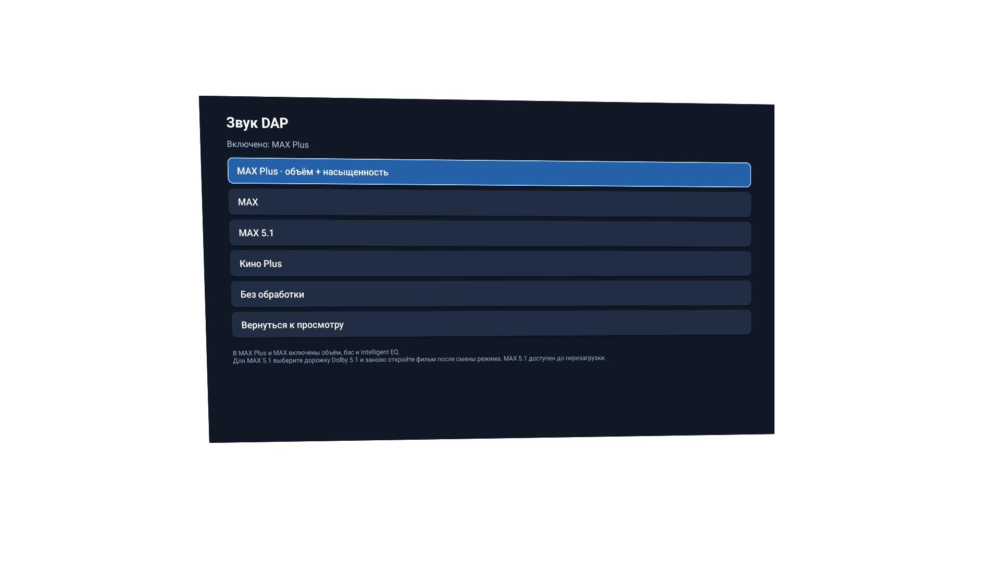
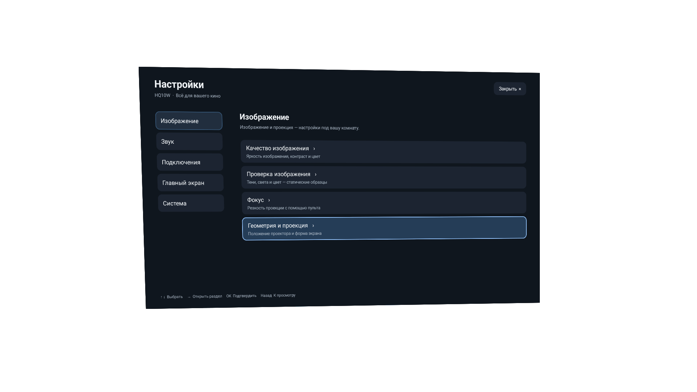
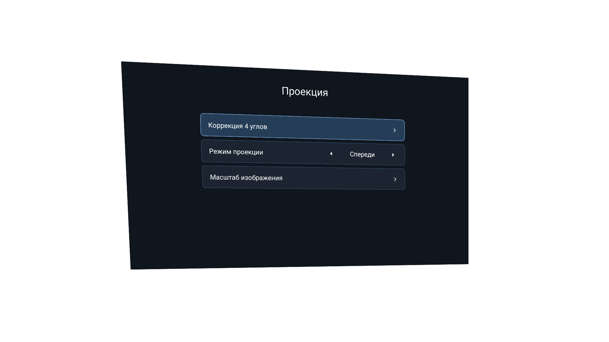
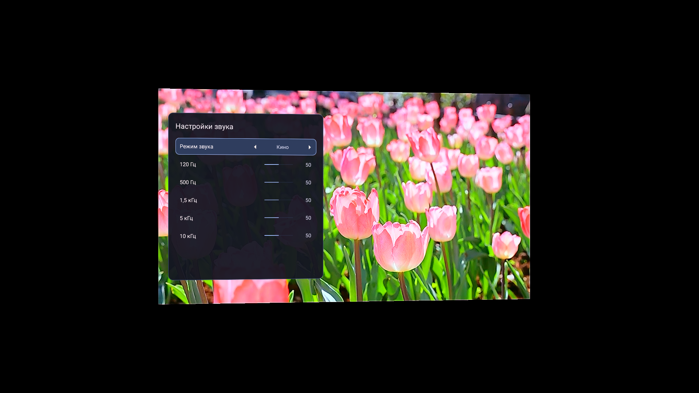
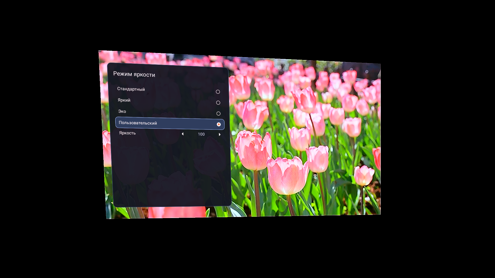
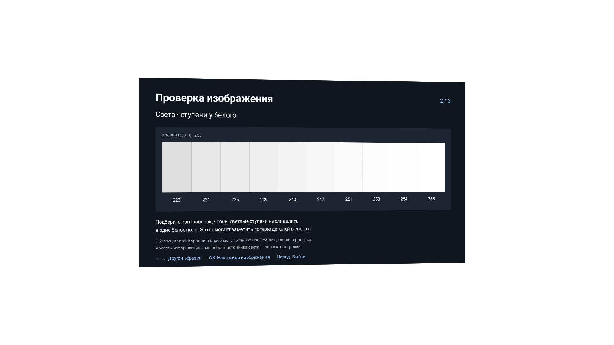
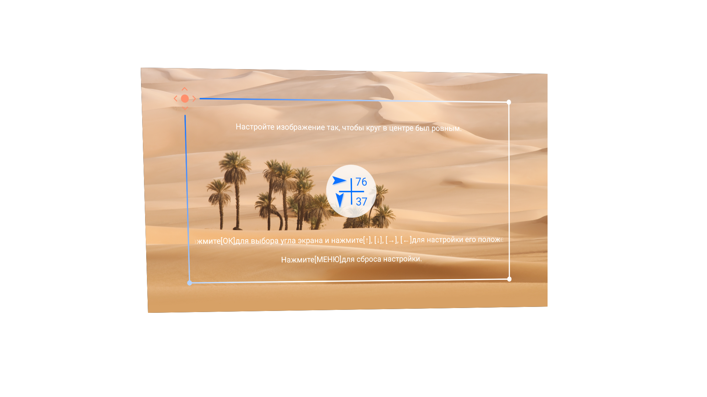
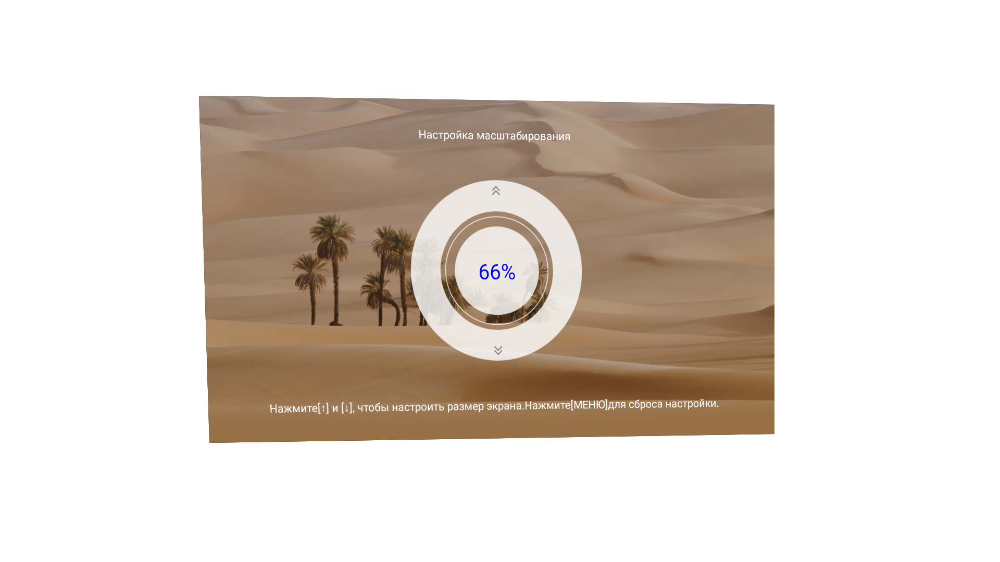

# HQ10W Clean Full

**Неофициальная прошивка для Everycom HQ10W: звук DAP, минималистичный Home и тёмные русские меню.**

Основа — заводская **V1.0.3.6 / Android 12 ARM32**. Основное внимание уделено звучанию встроенных динамиков, удобству управления с пульта и уменьшению лишней работы домашнего экрана.

> **Установка, переустановка и откат выполняются на свой страх и риск.** Пакет перезаписывает загрузочные разделы. Сбой питания во время записи может привести к невозможности загрузки устройства.
>
> Установка полного OTA и полный откат на устройстве пока не проверены.

[Изменения подробно](CHANGES-RU.txt) · [Полная инструкция](INSTALL-RU.txt) · [Результаты проверки](reports/VERIFICATION.json)

## Скачать прошивку

**[Скачать полный USB-комплект — HQ10W-Clean-Full-1-USB.zip · 1,84 ГБ](https://github.com/vgtstptlk/hq10w-clean/releases/download/full-1/HQ10W-Clean-Full-1-USB.zip)**

[Страница релиза](https://github.com/vgtstptlk/hq10w-clean/releases/tag/full-1) · [SHA256 файла](https://github.com/vgtstptlk/hq10w-clean/releases/download/full-1/HQ10W-Clean-Full-1-USB.zip.sha256) · [Инструкция по установке](INSTALL-RU.txt)

Комплект включает полный OTA, заводскую V1.0.3.6 для возврата, USB-скрипты и инструкции. Предварительно устанавливать заводскую основу не требуется. Для установки нужен именно **USB-комплект из Releases**. Автоматические архивы **Source code** содержат исходники репозитория.

После распаковки прочитайте `INSTALL-RU.txt` и начните с **CHECK**. Продолжайте только после свежего `CHECK_OK` и при точном совпадении платы `YG_5H080_693_RX_ZX` и разметки разделов.

## Скриншоты

Настоящие снимки экрана HQ10W. Нажмите на изображение, чтобы открыть оригинал в 1920×1080.

### Звук DAP · MAX Plus

[](docs/screenshots/01-dap-max-plus.png)

На этом проекторе дополнительно установлен **MAX 5.1**, поэтому он виден в меню. В USB-комплект этот режим не входит. Профили комплекта — **MAX Plus**, **MAX**, **Кино Plus** и **Без обработки**.

### Тёмные меню и настройка изображения

| Центр настроек | Проекция |
|:---:|:---:|
| [](docs/screenshots/02-dark-settings.png) | [](docs/screenshots/03-projection.png) |

| Изображение | Эквалайзер |
|:---:|:---:|
| [](docs/screenshots/04-picture.png) | [](docs/screenshots/05-equalizer.png) |

| Яркость | Проверка изображения |
|:---:|:---:|
| [](docs/screenshots/06-brightness.png) | [](docs/screenshots/09-image-check.png) |

| Коррекция четырёх углов | Масштаб изображения |
|:---:|:---:|
| [](docs/screenshots/07-four-corners.png) | [](docs/screenshots/08-image-scale.png) |

На экранах геометрии сохранены заводские цвета и тестовые элементы. Чёрные поля и форма изображения отражают настройки проекции в момент съёмки; снимки не ретушировались.

## Звук — главное изменение

В прошивку добавлены обработка **DAP** и приложение **«Звук DAP»** с управлением с пульта. Обработка расширяет стереосцену, подчёркивает речь и добавляет воспринимаемой насыщенности небольшим встроенным динамикам.

Используются:

- Виртуальное расширение стереосцены.
- Обработка диалогов и настройка эквалайзера.
- Intelligent EQ в режимах MAX и MAX Plus.
- Гармонический бас в режимах MAX и MAX Plus.
- Настройка совместной работы с заводской аудиоцепочкой.

### Профили

| Режим | Что меняется |
|---|---|
| **MAX Plus** | Режим по умолчанию: объём, речь, Intelligent EQ и гармонический бас с дополнительной настройкой середины. |
| **MAX** | Предыдущий вариант настройки объёма, Intelligent EQ и баса. Полезен для сравнения с MAX Plus. |
| **Кино Plus** | Альтернативный профиль виртуального объёма, речи и эквалайзера. |
| **Без обработки** | Отключает эффекты приложения DAP. Заводская аппаратная коррекция динамиков сохраняется. |

Профили переключаются без перепрошивки и перезагрузки. Откройте **библиотеку приложений → «Звук DAP»** и сравните один и тот же фрагмент при одинаковой громкости.

Восприятие объёма зависит от положения проектора, помещения, громкости и самого материала. Сравнивайте профили на знакомом фрагменте и выбирайте подходящий для своего расположения.

### Как подключена обработка

Перед запуском DAP отключается параллельная обработка SWS, чтобы эффекты не накладывались друг на друга. Заводская аппаратная калибровка динамиков сохраняется.

Предусмотрены проверка запуска аудиоцепочки и отдельная повторная проверка примерно через минуту. При обнаруженной ошибке выполняется попытка вернуть штатную обработку и отключить повторный запуск модификации. Это проверки запуска; универсального восстановления после любой потери звука они не гарантируют.

### Про 5.1 и Dolby Atmos

Встроенные динамики остаются **стереопарой**. DAP создаёт виртуальную пространственность, а возможности физической многоканальной акустики здесь не появляются.

Выбор дорожки «5.1» в Кинопоиске не гарантирует шесть отдельных каналов на входе эффекта: приложение или штатный декодер могут свести звук в стерео. Режим **MAX 5.1** в комплект не входит. Сертифицированный Dolby Atmos и универсальное исправление всех декодеров не заявляются.

## Интерфейс и управление

- Новый Home без заводской рекламной ленты: крупные плитки, библиотека приложений и управление с пульта.
- Тёмное оформление переработанных аппаратных меню и перевод затронутых китайских пунктов на русский.
- Исправленные переходы к коррекции четырёх углов и масштабу.
- Исправленный возврат из дочерних настроек в новую панель Home.
- Заводские цвета, круги и тестовые элементы на экранах настройки геометрии.

Заводской Home и NLProvision сохранены как часть штатной загрузки и резервного пути. Тепловые службы, защита от перегрева, источники, обновления и компоненты трансляции не удалялись.

## Производительность

Оптимизации сосредоточены на Home и лишних фоновых операциях:

| Изменение | Назначение |
|---|---|
| Поиск приложений и загрузка оформления в фоновом потоке | Уменьшить работу в потоке интерфейса, который обрабатывает пульт и отрисовку. |
| Кеш баннеров и иконок | Повторно использовать загруженные картинки. |
| Сохранение актуального каталога при возврате Home | Избегать полного поиска только из-за возврата из приложения. |
| Ограниченная очередь и отмена устаревших заданий | Не накапливать ненужные обновления каталога. |
| Остановка анимаций, видеообоев и статистики при уходе с Home | Уменьшить конкуренцию с приложением, в котором идёт фильм. |
| R8 и удаление неиспользуемых ресурсов | Уменьшить размер APK Home. |
| Отключённые по умолчанию анимации, дополнительные эффекты и статистика | Снизить визуальную и фоновую нагрузку. |
| Отключение постоянной записи OEM logcat-файлов | Уменьшить лишние записи на накопитель. |

APK Home занимает около **400 КиБ**. Это размер файла, а не расход RAM.

Ожидаемый результат — более отзывчивый Home и меньше повторной работы. Сопоставимых замеров FPS, времени загрузки, RAM и ускорения всей полной прошивки пока нет. Частоты CPU/GPU, лимиты охлаждения и мощность светового источника не повышались. Обработка DAP сама использует ресурсы процессора.

## Что отключено и удалено

При первом применении профиля для пользователя `0` отключаются:

| Компонент | Изменение |
|---|---|
| `com.newlink.service/com.newlink.service.service.DataUploadService` | Отключается проверенный компонент фоновой отправки данных. Остальной пакет сохраняется. |
| `com.zeasn.whale.saas/com.zeasn.tou_library.web.receiver.NetWorkStateReceiver` | Отключается один из сетевых триггеров заводского Whale Home. |
| `zeasn.open.technical.tv.store` | Отключается заводской магазин приложений для пользователя. |

`persist.sys.logcat.enable` устанавливается в `false`: в этой основе он управляет постоянной записью OEM logcat-файлов. Системный `logd` сохраняется.

Физически удалены старые `NLSetting_V2.odex` и `NLSetting_V2.vdex`, относящиеся к заменённому системному меню. Массового удаления системных APK нет. Сборка не является блокировщиком всей рекламы и аналитики сторонних приложений; DNS не меняется.

## Совместимость

| Параметр | Требование |
|---|---|
| Модель | Everycom HQ10W с совпадающей аппаратной ревизией |
| Проект платы | **`YG_5H080_693_RX_ZX`** |
| Платформа | `bigfish`, ARM32 |
| Исходная система | Android 12; дата сборки не новее заводской основы от 20.01.2026 |
| Разметка | Совпадение имён, размеров и начал затрагиваемых разделов |
| USB | FAT32, один первый раздел, накопитель доступен как `sda1` |

Название HQ10W на корпусе не подтверждает совместимость. Проект без суффикса `RX` или другая разметка означают остановку. Проверки выполняются и перед запросом установки, и в Recovery до первой записи образов.

Штатная V1.0.3.6 уже находится внутри полного OTA. Предварительно устанавливать её отдельно не требуется; предусмотрен переход со старой совместимой Android 12 основы.

## Установка

Для установки нужен **[`HQ10W-Clean-Full-1-USB.zip`](https://github.com/vgtstptlk/hq10w-clean/releases/download/full-1/HQ10W-Clean-Full-1-USB.zip)** размером примерно **1,84 ГБ**. В него входят наш полный OTA, заводской OTA для возврата, USB-скрипты и документы. Установочный архив опубликован отдельно в [GitHub Releases](https://github.com/vgtstptlk/hq10w-clean/releases/tag/full-1). Ветка репозитория содержит документацию, скриншоты и исходники.

Подготовленный USB-маршрут требует работающего Android. Интернет и ADB для него не нужны.

1. Распакуйте внешний USB-комплект на компьютере. Скопируйте **содержимое** папки `USB-root` в корень пустой флешки FAT32. Внутренние OTA ZIP оставьте архивами.
2. Сохраните `CHECK` в `MODE.txt`. Удалите старые `HQ10W-RESULT.txt` и `HQ10W-INSTALL-REQUESTED.txt`, если флешка использовалась раньше.
3. Отключите остальные накопители. Обычно выключите проектор, дождитесь остановки вентилятора, подключите USB и включите коротким нажатием.
4. Дождитесь Home и завершения фоновой проверки большого архива. В режиме `CHECK` установка не запрашивается. Прочитайте свежий `HQ10W-RESULT.txt`: для продолжения нужен **`CHECK_OK`**.
5. На компьютере задайте `INSTALL` в `MODE.txt` и повторите обычное выключение, подключение и включение. Скрипт проверит комплект и запросит Recovery с полным OTA.
6. Во время установки не отключайте питание и USB. После сообщения Recovery об успехе дождитесь Android; при необходимости выберите `Reboot system now`. После завершённой загрузки Home извлеките флешку.

```text
USB/
├── MODE.txt
├── newlink_update.sh
├── HQ10W-Clean-Full-1.zip
└── HQ10W-Full/
    ├── check-board.sh
    ├── rollback-prep.sh
    ├── factory-V1.0.3.6.zip
    ├── CHANGES-RU.txt
    └── INSTALL-RU.txt
```

Не переименовывайте OTA в `.bin` или `update.zip`: некоторые Recovery автоматически ищут файл `update.zip`. Длительное удержание питания не используется: на исходном проекторе оно вызывало заводской сброс.

`REBOOTING_TO_RECOVERY` и файл `HQ10W-INSTALL-REQUESTED.txt` подтверждают только запрос установки. Номер V1.0.3.6 также не отличает Clean от заводской основы. В нашей системе предусмотрен файл версии `/system/etc/hq10w-clean-release.txt`.

**[Полная инструкция с примерами Windows/macOS, сообщениями и проверкой результата →](INSTALL-RU.txt)**

### Переустановка, сброс и возврат

| Задача | Действие |
|---|---|
| Повторно записать эту систему с сохранением данных | Свежий `CHECK`, затем `INSTALL`; предварительно удалить старые служебные файлы с USB. |
| Очистить пользовательские настройки | Отдельный осознанный заводской сброс через системное меню. Он удаляет данные получателя. |
| Вернуть заводское ПО | `ROLLBACK` с тем же полным USB-комплектом. Устанавливается заводская **V1.0.3.6**, включая повторную запись загрузочных разделов. |

Обычная переустановка не очищает `/data` и не гарантирует устранение проблем сохранённых настроек или чужих модификаций. Существующая нераспознанная аудиоцепочка не перезаписывается автоматически.

Если Android не загружается, USB-скрипт не выполняется. Для ручного возврата требуется работающий Recovery и проверенный способ входа на конкретном устройстве. Универсальный аварийный способ здесь не заявляется.

## Контрольные суммы

SHA256 полного USB-комплекта `HQ10W-Clean-Full-1-USB.zip` (**1 844 162 535 байт**):

```text
08d443b6d01b7c3c471be3cd50761a8e7b9ea3d3067200fabd8b4e2f715fb473
```

Этот же хеш находится в [отдельном файле SHA256 в релизе](https://github.com/vgtstptlk/hq10w-clean/releases/download/full-1/HQ10W-Clean-Full-1-USB.zip.sha256). Внутри комплекта `SHA256SUMS.txt` содержит суммы его отдельных файлов.

SHA256 внутреннего полного OTA `HQ10W-Clean-Full-1.zip`:

```text
929b3fc9a226e0fb78d369992ce562ced7bf91364541c39f91264d2c3a46211e
```

SHA256 вложенного заводского `factory-V1.0.3.6.zip`:

```text
943268ea81004580476cfbf2069c212996d852f5dbc08a3533a6f97f11bfc292
```

Две последние суммы относятся к внутренним OTA. Для проверки скачанного внешнего USB-комплекта используйте первую сумму выше.

| Проверка | Статус |
|---|---|
| Целостность ext4 и чтение добавленных файлов из образов | Пройдена на компьютере |
| Полное покрытие блоков system/vendor и обратная распаковка потоков | Пройдена на компьютере |
| Криптографическая подпись OTA и соответствие ключа заводским trust store | Пройдена на компьютере |
| Guard платы и USB | Проверен на сохранённых данных и в моделируемых сценариях |

Отчёты: [OTA](reports/VERIFICATION.json), [изменения образов](reports/IMAGE-CHANGES.json), [проверка платы](reports/BOARD-GUARD-CHECK.json), [проверка USB](reports/USB-GUARD-CHECK.json).

Подпись использует публичный тестовый ключ AOSP, которому уже доверяет заводская прошивка, и её унаследованный формат SHA1/RSA. Проверка подписи не отключается. Такой общий ключ не подтверждает происхождение пакета как закрытый производственный ключ. Контрольные суммы файлов рассчитываются отдельно с SHA256.

## Для разработчиков

- [`build.py`](tools/firmware/build.py) — офлайн-изменение заводских ext4, полные потоки, упаковка, подпись и проверка OTA.
- [`distribute.py`](tools/firmware/distribute.py) — сборка USB-комплекта и документов.
- [`home.sh`](tools/firmware/home.sh), [`first-boot.sh`](tools/firmware/first-boot.sh) — выбор Home и подключение изменений при загрузке.
- [`check-board.sh`](tools/firmware/check-board.sh), [`usb-start.sh`](tools/firmware/usb-start.sh) — проверки и подготовка запроса Recovery.
- [`test_board_guard.py`](tools/firmware/test_board_guard.py), [`test_usb_guard.py`](tools/firmware/test_usb_guard.py) — проверки защитных ветвей на компьютере.

Это модификация заводских бинарных образов; исходников всего BSP здесь нет. Скрипты рассчитаны на подготовленное рабочее дерево CleanYourTV с отдельно полученной заводской основой, чистыми APK, инструментами ext4, Android SDK и материалами подписи. Чистый клон этой папки не является самодостаточной сборочной средой.

Локальные `backup/`, `release-work/`, keystore и снимки `/data` не предназначены для публикации вместе с исходниками.

## Об ошибках и правах

При сообщении об ошибке укажите проект платы, исходную версию, режим `MODE.txt`, свежий результат проверки и точный текст ошибки Recovery. Не прикладывайте пароли, VPN-профили, DRM-разделы и дамп `/data`.

Проект использует Home из CleanYourTV. Права на заводскую основу, OEM-меню и бинарные Dolby-компоненты остаются у их владельцев; лицензия Home не перелицензирует эти компоненты. Сборка неофициальная и не является сертифицированным продуктом Dolby.

## Проверка публикуемых файлов

```sh
python3 tools/audit_repository.py
python3 tools/firmware/test_board_guard.py
python3 tools/firmware/test_usb_guard.py
```

Для проверок нужен Python 3.11+ и `/bin/sh` (Linux/macOS). Проверка репозитория отклоняет посторонние бинарные файлы, архивы, ключи, локальные адреса и домашние пути. Исключение — девять просмотренных PNG в `docs/screenshots/`: для них проверяются точные имена и SHA256, структура PNG и отсутствие текстовых и EXIF-метаданных. Тесты скриптов работают на текстовых фикстурах без подключения к проектору.
